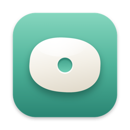
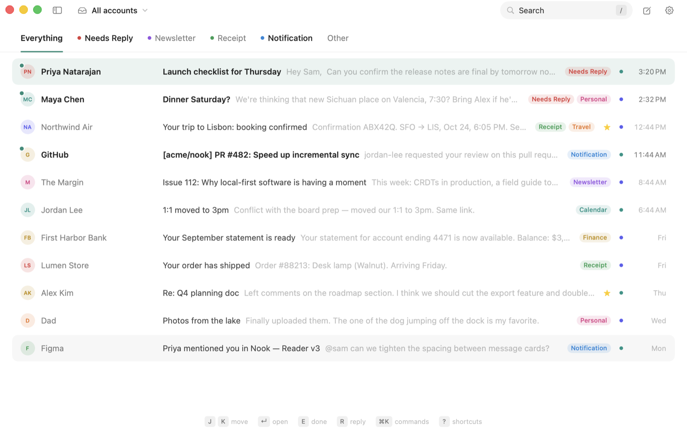
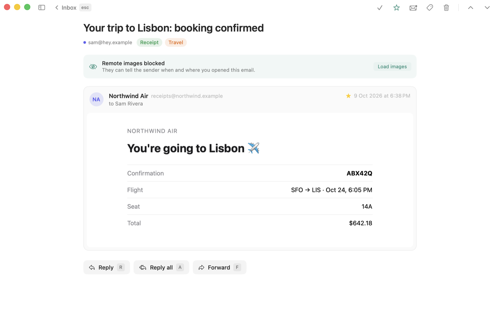
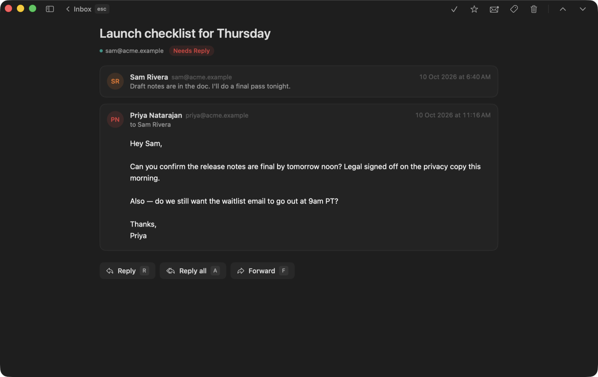
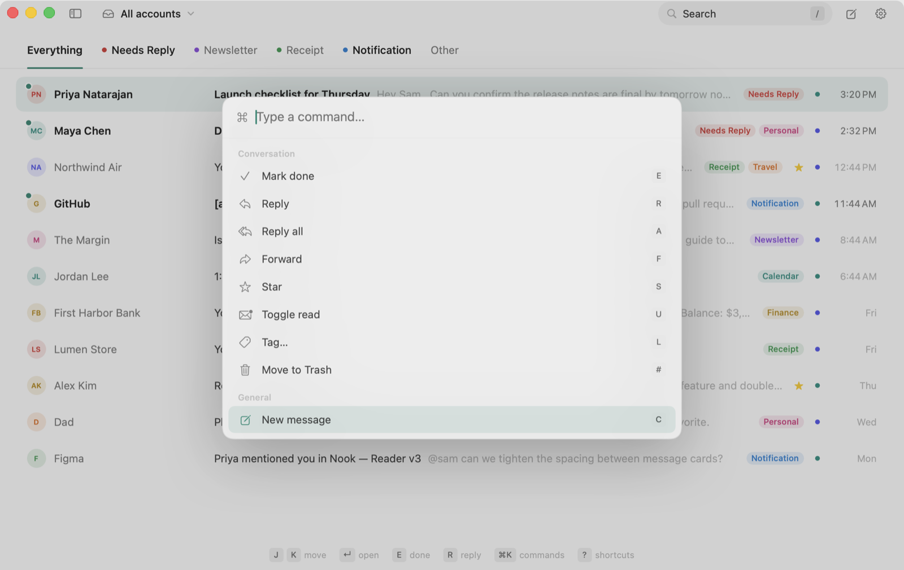

<p align="center">
  
</p>

<h1 align="center">Nook</h1>

<p align="center">
  A private, local-first email client for macOS.<br>
  Fast keyboard-driven mail, stored on your Mac and tagged by a model that runs on your Mac.
</p>

<p align="center">
  
</p>

## Why Nook

- **Local-first.** Your mail is synced into a SQLite database on your Mac. Search, filters and tags all run locally, so they're instant and work offline.
- **Encrypted at rest.** The local mail store is encrypted with SQLCipher (AES-256) using a key that never leaves your Mac's Keychain.
- **Private by default.** There's no Nook server. The app talks straight to Gmail using an OAuth client you control. Tokens live in the macOS Keychain. Remote images, which often act as tracking pixels, are blocked unless you load them, and JavaScript in email never runs.
- **On-device AI tagging.** New mail is tagged with labels you define, such as *Needs Reply*, *Receipt* or *Newsletter*, by **Apple Intelligence** or any model you run in **[Ollama](https://ollama.com)**, including your own fine-tunes. No email content leaves your Mac.
- **Split inbox.** Tags become tabs (*Needs Reply*, *Newsletter*, …) and everything else lands in *Other*. Press Tab to work through them one at a time.
- **Built for the keyboard.** Single-key shortcuts in the style of Superhuman, a ⌘K command palette, and automatic advance to the next conversation after you finish one. The sidebar stays out of the way until you want it (`⌘\`).
- **Many accounts, one inbox.** See every account together, or switch to one with ⌘1–⌘9 (⌘0 for all).
- **Works with your AI assistant.** A built-in, local [MCP](https://modelcontextprotocol.io) server lets Claude Code, Claude Desktop and other MCP clients search and read your mail and draft replies for you to review. It's off until you turn it on.
- **Native.** SwiftUI, light and dark mode, and a single pinned dependency (SQLCipher, for encryption).

| Reader | Dark mode | Command palette |
| --- | --- | --- |
|  |  |  |

## Download

Get the latest **[Nook.dmg from Releases](https://github.com/supergrow-ai/nook/releases/latest)**, open it and drag Nook to Applications. Builds are signed with a Developer ID and notarized by Apple.

You'll still need your own Google Cloud OAuth client to connect Gmail; [Connecting Gmail](#1-connecting-gmail) walks you through it. To build from source instead, see [Getting started](#getting-started).

## Requirements

- macOS 26 (Tahoe) or later
- To build from source: Swift 6.2+ (Xcode 26, or just the Command Line Tools)
- A Gmail account and a Google Cloud OAuth client (free; see below)
- For tagging (optional): [Ollama](https://ollama.com) with a model pulled (recommended), or Apple Intelligence turned on

## Getting started

```bash
git clone https://github.com/supergrow-ai/nook.git
cd nook
./scripts/build-app.sh          # builds build/Nook.app
open build/Nook.app
```

To try the app without connecting an account, run it on sample data:

```bash
open build/Nook.app --args --demo
```

On first launch, Nook walks you through three steps: **connect mail**, **choose how tagging runs**, and optionally **connect an AI assistant**. The sections below cover each one in detail.

### 1. Connecting Gmail

Nook uses your own OAuth client, so no third party is ever involved. This takes about five minutes, once:

1. In the [Google Cloud Console](https://console.cloud.google.com/), create a project, then go to **APIs & Services → Library** and **enable the Gmail API**.
2. Under **Google Auth Platform → Audience**, keep the user type **External** and the status **Testing**. Under **Test users**, click **Add users** and add *every* address you'll connect. Only test users can sign in while the app is in Testing.
3. Under **Clients** (or **Credentials → Create credentials → OAuth client ID**), create a client with application type **Desktop app**. The Scopes step is optional: Nook asks for what it needs when you sign in.
4. Paste the client ID and secret into Nook (on the welcome screen, or later in **Settings → Accounts**) and click **Connect Gmail**.

Your browser opens Google's sign-in. Expect two screens:

- **"Google hasn't verified this app."** This is expected for your own client. Click **Continue**.
- **"Select what Nook can access."** Make sure **Read, compose, and send emails from your Gmail account** is ticked, then click **Continue**.

Google then redirects to a one-time listener on `127.0.0.1`, and Nook takes over. The first sync downloads your inbox plus the last 60 days. Add more accounts in **Settings → Accounts**.

You can also provide the client through `NOOK_GOOGLE_CLIENT_ID` and `NOOK_GOOGLE_CLIENT_SECRET` environment variables.

> **Sign-ins expire after 7 days while the app is in Testing.** That's a Google rule for unpublished apps. To stop it, fill in the **Branding** page (app name and contact emails), then click **Publish app** under **Audience**. The app stays unverified, which is fine for your own use (up to 100 users).

### 2. Setting up tagging

Tagging runs on a model on your Mac. Pick one during onboarding or in **Settings → Intelligence**.

**Ollama (recommended).** Free, open source, and works with any model, including your own fine-tunes:

```bash
brew install ollama
brew services start ollama   # runs in the background and starts at login
ollama pull llama3.2         # about 2 GB
```

You can also download the app from [ollama.com](https://ollama.com). Nook notices Ollama as soon as it's running, so there's nothing to restart. To use a different model, `ollama pull` it and choose it in **Settings → Intelligence**.

**Apple Intelligence.** Uses Apple's on-device model (Apple silicon only). Turn it on in **System Settings → Apple Intelligence & Siri**. If the switch is greyed out, set Siri's language to match your Mac's language. The model downloads in the background after you turn it on.

**Automatic** (the default) uses Ollama when it's running with your model and falls back to Apple Intelligence.

### 3. Connecting an AI assistant (optional)

See [Using Nook from an AI assistant](#using-nook-from-an-ai-assistant-mcp) below.

## Keyboard shortcuts

| Navigate | | Act | | Write | |
| --- | --- | --- | --- | --- | --- |
| `j` / `k` | Next / previous | `e` | Mark done (archive) | `c` | Compose |
| `↵` | Open | `#` | Trash | `r` | Reply |
| `esc` | Back | `s` | Star | `a` | Reply all |
| `tab` / `⇧tab` | Next / previous split | `⇧U` | Show only unread | | |
| `/` | Search | `u` | Toggle read | `f` | Forward |
| `⌘K` | Command palette | `l` | Tag | `⌘↵` | Send |
| `⌘0`–`⌘9` | All accounts / one account | `z` | Undo | `?` | All shortcuts |
| `⌘\` | Show or hide sidebar | | | | |

Go-to sequences: `g i` inbox, `g s` starred, `g t` sent, `g a` all mail, `g #` trash.

## Search

Search covers every message stored locally, with full-text prefix matching. It also understands Gmail-style operators:

```
from:anna  to:ben  tag:receipt  is:unread  is:starred  in:sent  account:work  "exact phrase"
```

## Tagging and the split inbox

Each tag has a name and a plain-language description. The model reads the description to decide whether the tag fits, so the descriptions are the "custom model": edit them in **Settings → Tags** to teach Nook what each tag means to you. Tags you add by hand (`l`) are never overwritten.

Tags marked **Inbox tab** become tabs across the top of the inbox. By default those are Needs Reply, Newsletter, Receipt and Notification. Conversations that don't fall into any tab show up under **Other**.

**Unread only**, in the account menu at the top left (or `⇧U`), shows only conversations with something unread, and Nook remembers it, so your inbox can open to just what's new. A conversation you read stays in the list until you switch tabs or accounts, so it doesn't vanish while you're in it.

Inside the app, Nook avoids counters on purpose: a tab with unread mail just reads a little darker, and the sidebar uses a small dot. The one number is optional: the unread count on the Dock icon, which you can turn off in **Settings → General**.

Tagging starts as soon as mail arrives, newest first, alongside the sync. See [Setting up tagging](#2-setting-up-tagging) to choose the engine.

## Using Nook from an AI assistant (MCP)

Nook includes `nook-mcp`, a [Model Context Protocol](https://modelcontextprotocol.io) server over your local mail store.

1. Turn it on. Onboarding offers this as its last step, or use **Settings → Integrations** later.
2. Connect your client. Both places show these commands with the right path for your install, with a Copy button.

```bash
# Claude Code
claude mcp add nook -- /Applications/Nook.app/Contents/MacOS/nook-mcp
```

```jsonc
// Claude Desktop: claude_desktop_config.json → "mcpServers"
"nook": { "command": "/Applications/Nook.app/Contents/MacOS/nook-mcp" }
```

| Tool | What it does |
| --- | --- |
| `list_accounts` | Connected accounts and unread counts |
| `list_tags` | Tags, their descriptions, and inbox counts |
| `search_threads` | Search with Nook's syntax (`from:`, `tag:`, `is:unread`, …), by mailbox, tag or account |
| `get_thread` | Every message in a conversation, as plain text |
| `draft_reply` | Opens a reply in Nook, prefilled, for you to review |
| `compose_draft` | Opens a new message in Nook, prefilled, for you to review |

**What it can't do:** send mail, delete anything, or reach the network. The server talks only to the client that launched it, over stdio. Drafts open in Nook (through `nook://` links), and nothing goes out until you press Send. Turning the setting off takes effect on the next tool call. Keep in mind that whatever your assistant reads, it sends to its own model provider, so connect only assistants you trust with your mail.

## Troubleshooting

| What you see | Why, and what to do |
| --- | --- |
| **"Access blocked: … has not completed the Google verification process"** (Error 403: access_denied) | The address you signed in with isn't a test user. Add it under **Google Auth Platform → Audience → Test users**, wait a minute, and connect again. |
| Blocked with a message about your **administrator** | Google Workspace domains can block third-party apps. In the Workspace Admin console, go to **Security → Access and data control → API controls → Manage third-party app access** and mark your OAuth client ID as trusted. |
| **Publish app** is greyed out | Complete the **Branding** page first. |
| **"Gmail rejected the sign-in"** after about a week | The Testing-mode 7-day expiry. Remove and re-add the account, or publish the app (see above). |
| **"Quota exceeded for quota metric … per minute per user"** | Gmail's per-user rate limit. Nook paces itself under it and retries automatically, so this clears on its own. If you saw it in an older build, update. |
| Tagging status says **"No on-device model available"** | Ollama isn't running or the model isn't pulled (`brew services start ollama`, `ollama pull llama3.2`), or Apple Intelligence is off. **Settings → Intelligence** shows exactly which. |
| Apple Intelligence says **"Turn on Apple Intelligence in System Settings"** | It's switched off in **System Settings → Apple Intelligence & Siri**. Apps can't turn it on for you. |
| Your MCP client says **"Nook's MCP access is turned off"** | Turn it on in **Settings → Integrations**. |
| After a rebuild, **"Nook wants to use your confidential information stored in … your keychain"** | The build has a new identity (ad hoc signing). Enter your login keychain password and click **Always Allow**, or run `scripts/setup-signing.sh` once so it stops. If your keychain password doesn't match your Mac password (common after a password reset), click **Deny**, run the script, rebuild, and use **Settings → Accounts → Sign in again**. |

## Architecture

```
Sources/
  NookCore/        Everything that isn't UI. Fully unit-tested.
    Storage/       SQLite store, FTS5 search, thread queries, search parser
    Gmail/         REST client, OAuth (PKCE + loopback), Keychain token store
    Sync/          SyncEngine: full sync, then incremental via Gmail history
    Mail/          MIME parsing/building, addresses, replies, safe HTML
    Intelligence/  Tagger, prompt, Apple Intelligence + Ollama backends
    MCP/           The MCP server (JSON-RPC over stdio)
    Support/       Keyboard shortcuts, nook:// links
  Nook/            The SwiftUI app
    App/           AppStore (state + actions), KeyRouter, demo data
    Views/         Sidebar, split inbox, reader, compose, palette, settings
  NookMCP/         The nook-mcp executable, shipped inside Nook.app
Tests/
  NookCoreTests/   Swift Testing suites, with fakes for Gmail and HTTP
```

**Syncing in the background.** Nook syncs whenever it's running, whether or not it's in front, and keeps running when you close its window (click the Dock icon to bring it back; ⌘Q quits). It holds an activity assertion so App Nap doesn't delay the 30-second sync while it's hidden. Turn on **Settings → General → Open Nook at login** so it starts with your Mac. The Dock icon can show your unread inbox count (also in General).

**How sync works.** The first sync downloads your inbox plus the last 60 days of mail and stores Gmail's `historyId`. Every 30 seconds after that, and whenever the app becomes active, Nook asks Gmail only for the history since that cursor and applies new messages, deletions and label changes. If the cursor expires, Nook falls back to a full resync that refreshes labels without downloading bodies again. Actions such as archive, star and read are applied locally first, so the UI never waits on the network, then sent to Gmail. If a Gmail call fails, Nook resyncs.

**How it stays fast.** Every switch and action has a 100 ms budget, enforced by `PerformanceTests` on a 10,000-message mailbox. Lists and counts read a small per-conversation index (`threads`, `thread_tags`) that's updated on every write, instead of scanning messages. Message bodies live in their own table and are read only when you open a conversation. The list loads 100 conversations at a time. The UI reads through a separate read-only SQLite connection, so a running sync never blocks it.

**How encryption works.** On first launch Nook creates a random 256-bit key and keeps it in the Keychain, tied to this Mac. The whole store, including the search index, is encrypted with [SQLCipher](https://www.zetetic.net/sqlcipher/) (AES-256), pinned to a checksum-verified release. Upgrading from an unencrypted store converts it in place on first launch. `nook-mcp` is signed with the app's identity, so it can read the key without a prompt. A store copied to another Mac can't be opened there: Nook sets it aside and downloads your mail again.

**What encryption does and doesn't protect against.** It keeps your mail unreadable to other user accounts, to anyone with your disk or backups but not your Mac login, and to tools that read files directly. It doesn't protect against malicious software already running as you: like any app, Nook can't defend its data from code with your own permissions, which can read the Keychain the same way Nook does. When an older, unencrypted store is converted, the old file is deleted but not overwritten, so pieces of it can linger in free disk space or older backups. Keep FileVault on, which encrypts the whole disk.

The MCP on/off switch in Settings is a consent setting, not a security boundary: it stops well-behaved assistants, but software running as you could change it.

**Where data lives.**

| What | Where |
| --- | --- |
| Mail, tags, search index | `~/Library/Application Support/Nook/nook.sqlite`, encrypted with SQLCipher (AES-256), readable only by you |
| Database encryption key | macOS Keychain, created on first launch, this device only |
| OAuth tokens, client secret | macOS Keychain (`com.devenbhooshan.nook`, this device only) |
| Preferences | `com.devenbhooshan.nook` defaults domain |
| Network traffic | `gmail.googleapis.com`, `oauth2.googleapis.com`, `openidconnect.googleapis.com`, and your Ollama server if you use one |
| MCP | No network at all: stdio to the client that launches `nook-mcp` |

## Development

```bash
./scripts/setup-signing.sh               # once: a local signing certificate, so rebuilds keep the same identity
./scripts/test.sh                        # run the test suite
swift run Nook --demo                    # run from source on sample data
./scripts/build-app.sh --debug           # debug .app bundle
```

`build-app.sh` signs with the most stable identity it finds: `$NOOK_SIGN_IDENTITY`, then a **Developer ID Application** certificate in your keychain, then the local certificate from `setup-signing.sh`, then ad hoc. Have one of the first three in place before you connect real accounts. Ad hoc builds look like a new app to macOS on every rebuild, so Keychain asks you to approve access to Nook's saved sign-ins each time.

### Releasing

`scripts/release.sh` builds a signed, notarized `build/Nook-<version>.dmg`. It runs the tests, signs the app and `nook-mcp` with the hardened runtime and a secure timestamp, packages a `.dmg`, notarizes it with Apple, and staples the ticket. Once per Mac, you need:

1. A **Developer ID Application** certificate in your login keychain.
2. Notarization credentials in your keychain: `xcrun notarytool store-credentials nook-notary --apple-id you@example.com --team-id TEAMID`. It asks for an app-specific password from appleid.apple.com.

No identity or credentials live in the repository. Forks sign with their own (`NOOK_SIGN_IDENTITY`, `NOOK_NOTARY_PROFILE`).

`scripts/test.sh` adds the framework paths Swift Testing needs when only the Command Line Tools are installed. With Xcode, plain `swift test` works too.

Demo mode accepts flags that are handy for screenshots and UI work: `--open <n>`, `--compose`, `--palette`, `--unread`, `--split <tag>`, `--settings`, `--tooltips`, `--onboarding` (the assistant step) or `--onboarding tagging`, `--dark`, `--windowed` and `--close-window`.

To try the MCP server against a scratch store in a debug build: `NOOK_MCP_ENABLED=1 swift run nook-mcp --database /tmp/nook.sqlite` (or set `NOOK_DATABASE`). Release builds ignore `NOOK_MCP_ENABLED` and only honor the switch in Settings.

Local and ad hoc builds can't use the hardened runtime, which requires a Team ID. Builds you share should be signed with a Developer ID.

Regenerate the app icon with `swift scripts/make-icon.swift docs/icon.png`.

See [CONTRIBUTING.md](CONTRIBUTING.md) for guidelines.

## Roadmap

1. **Snooze and reminders** (top priority)
2. Attachments: viewing and sending
3. Rich-text compose, signatures, send later, undo send

## License

[MIT](LICENSE)
